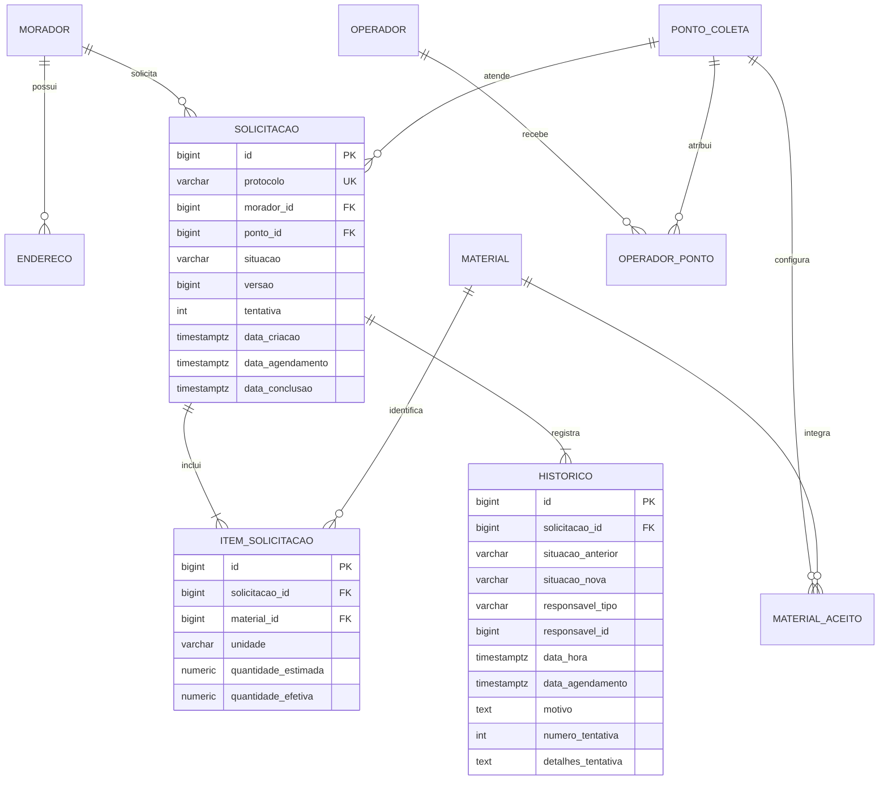

# Modelo e regras de negócio

O enunciado de Programação Web I define os requisitos RF01–RF15, RN01–RN06 e RNF01–RNF08. A proposta da equipe e os guias de etapa descrevem os atores, as telas, o modelo inicial e a organização em camadas.

## Diagrama entidade-relacionamento

O endereço de atendimento está embutido na solicitação. A unidade fica no item. Os dois são copiados dos cadastros para preservar o histórico. Um vínculo de material tem chave única por ponto e material, e um item tem chave única por solicitação e material. O histórico usa tipo e ID do ator para registrar moradores, operadores e o administrador fictício no mesmo formato.

## Ciclo do recolhimento

| Situação | Ações e destinos |
| --- | --- |
| Solicitada | Corrigir endereço e itens, agendar, recusar ou cancelar |
| Agendada | Iniciar recolhimento, reagendar ou cancelar |
| Em recolhimento | Concluir ou registrar falha e voltar a agendada |
| Concluída, recusada ou cancelada | Consultar histórico |

A criação valida ponto ativo, atendimento domiciliar, endereço do morador, materiais ativos e aceitos, limites, unidade e ausência de duplicatas. A conclusão exige o valor efetivo de todos os itens e pelo menos um valor positivo. O operador registra o início de cada tentativa e o histórico guarda o motivo e a nova data de reagendamento.

O ponto fica bloqueado para escrita enquanto o serviço valida uma solicitação nova ou corrige uma aberta. Assim, a inativação ou remoção de vínculo verifica um estado consistente. Material, morador e ponto têm inativação. A alteração da unidade de um material exige remover antes os limites definidos nessa unidade.

A coluna de versão usa `@Version`. Correções e mudanças de situação atualizam a versão e gravam histórico na mesma transação. Uma segunda atualização da mesma versão retorna conflito. Criação, itens e histórico também compartilham uma transação. O banco garante as chaves estrangeiras, as unicidades e os limites numéricos estruturais.

## Cobertura do escopo

| Requisitos | Implementação |
| --- | --- |
| RF01–RF07 | Cadastros, filtros públicos, materiais aceitos e operadores |
| RF08–RF14 | Solicitações, escopo dos atores, correção, transições e histórico |
| RF15 | Contagens por situação e totais efetivos por material e unidade |
| RN01–RN06 | Validações em serviços transacionais e restrições PostgreSQL |
| RNF01, RNF03, RNF05, RNF06 | Spring Boot, JPA, REST, Flyway, erros JSON e perfis fictícios |
| RNF02 | Interface responsiva, formulários, mensagens de campo e confirmação de cancelamento |
| RNF04 | Paginação de até 100, índices e ensaio com 1.000 solicitações |
| RNF07–RNF08 | Swagger, exemplos, dados fictícios, suíte de integração e evidências |
